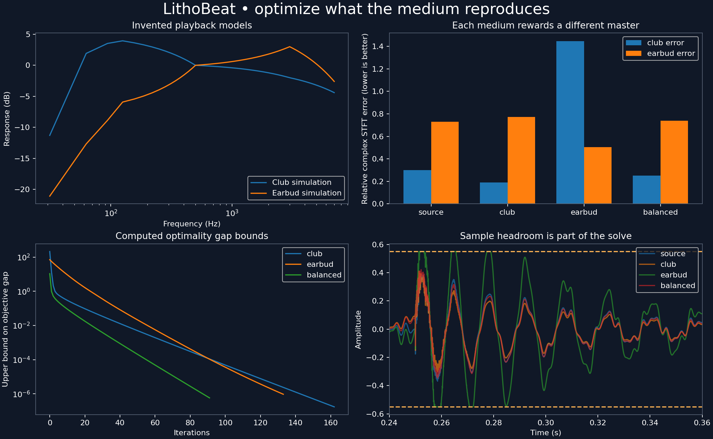

# LithoBeat

A working, reproducible speaker-aware mastering prototype: design a digital waveform for the output of a fixed playback model, using a two-dimensional complex STFT target and an explicit sample-amplitude constraint.



**Status:** tested synthetic research demo. No actual club speakers, AirPods, rooms or production recordings were measured. No listening-preference improvement is claimed.

## Reproduce

Python 3.11 or newer; the checked-in dependency versions were exercised with Python 3.12. No external audio downloads, API keys, training services or GPUs are needed.

```bash
python -m venv .venv
source .venv/bin/activate
python -m pip install -r requirements.txt
python -m lithobeat.demo --out examples/generated
python -m unittest discover -s tests -v
```

The demo makes an original four-second mono beat at 16 kHz, solves three constrained problems, writes WAVs, plots, iteration histories, calibration diagnostics, tradeoff results and a SHA-256 manifest. It rejects failure to reach the stated tolerance. WAV masters are float64 and are read back to verify exact samples and the cap. Numerical results should agree to floating-point tolerance on other platforms; PNG bytes can differ with font/rendering versions. CI repeats the demo and tests. Running from the repository root avoids installation; `pip install -e .` is also supported.

## Measured results of this synthetic experiment

Relative complex STFT error against the same fixed target, lower is better:

| Master | Club-model error | Earbud-model error | Relative waveform change | Master sample peak |
|---|---:|---:|---:|---:|
| Source | 0.3014 | 0.7292 | 0 | 0.4800 |
| Club | 0.1900 | 0.7721 | 0.2364 | 0.5127 |
| Earbud | 1.4463 | 0.5038 | 1.0520 | 0.5500 |
| Balanced | 0.2511 | 0.7384 | 0.1541 | 0.5272 |

The dedicated club master reduces its model's error by **37.0%**; the dedicated earbud master reduces its model's error by **30.9%**. This has costs: the earbud master substantially worsens the club error and raises RMS by approximately 6.1 dB. The balanced master minimizes equal-weight expected squared error plus regularization; it does not improve every medium. These are model-specific coefficient errors, not listening scores.

All digital masters satisfy the imposed sample cap of **0.55** without post-solve normalization or clipping. The earbud optimum has 1,131 samples at the cap. Its 4x oversampling peak diagnostic is about **0.5753**, illustrating why a sample cap is not a true-peak constraint. The implementation does not claim the oversampling diagnostic is an exact continuous-time bound.

The club, earbud and balanced solves took 162, 133 and 91 projected-gradient steps. Their evaluated exact-arithmetic gap-bound formulas give objective gaps below approximately 0.00000018, 0.00000095 and 0.00000058 respectively (floating-point diagnostics, not interval-certified bounds). The stopping threshold is 1e-8 times the larger of one and the initial feasible objective.

Increasing the earbud ridge weight from 0.01 to 2.0 reduces relative waveform change from 1.5712 to 0.1080, while worsening target error from 0.4630 to 0.7019. This quantifies the preservation/compensation tradeoff. Full precision, software versions, traces and sweep results are in [results.json](examples/generated/results.json).

## The optimization

For each candidate real waveform, calculate its complex frequency-by-time image. Multiply that image by each fixed profile. Minimize squared distances to the fixed target, weighted across media, plus a positive quadratic waveform-preservation penalty. Every waveform sample must lie within the positive and negative amplitude cap. In executable notation:

```python
# A: fixed STFT; h: frozen profiles; w: media probability weights
# t: fixed target; x: source; z: candidate waveform
loss = 0.5 * sum(w[m] * norm(h[m, :, None] * A(z) - t)**2
                 for m in range(len(w))) + 0.5 * ridge * norm(z-x)**2
# constraints: -cap <= z[j] <= cap for every sample j
```

The target preserves source phase and gently emphasizes low frequencies around known generated kick onsets. It is fixed before solving. This is compensation toward a chosen complex target, not semantic recognition or a learned preference metric.

The proved result is existence and uniqueness of the global minimizer, convergence of projected gradient, feasibility of every iterate, and an objective-gap upper bound under the fixed linear-model, convex-box and positive-ridge assumptions. The derivation also gives a conditional uniform-model-error regret result for learned media. It explicitly does **not** prove global optimality for arbitrary nonlinear learned playback systems. See [the full derivation](docs/DERIVATION.md).

## Files and audio

- [core.py](lithobeat/core.py): Parseval STFT and tested real adjoint, constrained solver, gap formula, parameterized media, calibration fit.
- [demo.py](lithobeat/demo.py): seeded synthesis, three media-weight configurations, cross-device comparisons, regularization sweep, plots and checked exports.
- [tests](tests/test_core.py): exact special case, finite-difference gradient, independent SciPy optimizer, certificate, transform/adjoint, validation, null media, fit and export checks.
- [Source](examples/generated/source.wav), [club master](examples/generated/club.wav), [earbud master](examples/generated/earbud.wav), [balanced master](examples/generated/balanced.wav): digital inputs to the virtual playback model.
- Files ending in `through_club.wav` and `through_earbud.wav`: synthetic reproduced output, rendered by adjoint STFT synthesis after profile multiplication. These are not physical microphone recordings, and the master amplitude cap does not constrain these outputs.
- [Spectrograms](examples/generated/spectrograms.png), [portrait graphic](examples/generated/tiktok_portrait.png), [TikTok shot/voiceover guide](docs/TIKTOK.md).
- [Photolithography analogy and its limits](docs/ANALOGY.md), [production-audio and measurement roadmap](docs/PRODUCTION.md).

## Extend or supply measured profiles

```python
import numpy as np
from lithobeat import STFT, Problem, solve

# owned_audio: finite mono waveform; measured_h: full complex FFT-bin response
# sr and FFT conventions must match your calibration data
analysis = STFT(len(owned_audio), size=512)
source = analysis.pad(owned_audio)
target = analysis.analysis(source)
problem = Problem(analysis, source, target,
                  np.asarray(measured_h)[None, :], np.ones(1), ridge=.08, cap=.55)
master, certificate = solve(problem)
assert certificate['converged']
```

`fit_diagonal(reference_stft, recorded_stft)` estimates a frozen profile from aligned paired training coefficients. Split independent recordings for testing. Do not substitute a magnitude-only curve for a validated complex response without stating the phase assumption. The synthetic fitting example uses independent coefficient arrays, so it validates estimation algebra only. The optimization demo itself uses the known invented profiles, not the estimates.

The implemented virtual medium is diagonal in a redundant STFT. It is not exactly causal FIR convolution; the coefficient loss and synthesized listening output are distinct. Periodic boundaries and zero-padding are specified in the derivation. A production implementation needs calibrated forward-model validation, proper acoustic boundary treatment, full bandwidth and stereo constraints. Source-file redistribution requires rights. The shipped beat is synthesized solely from oscillators and seeded noise.

## Provenance and license

This implementation develops the earlier private LithoBeat spectral-ridge prototype into a new constrained waveform solver. That earlier prototype solved an unconstrained pixel problem and imposed practical caps afterward; its theorem did not certify the final rendered waveform. This release replaces that optimization path and does not carry forward claims about symbolic recovery or real-device performance.

Code, documentation, figures and generated audio are provided under the MIT license. No copyrighted commercial recordings are included. No claim of novelty for inverse filtering or convex quadratic optimization is made.
